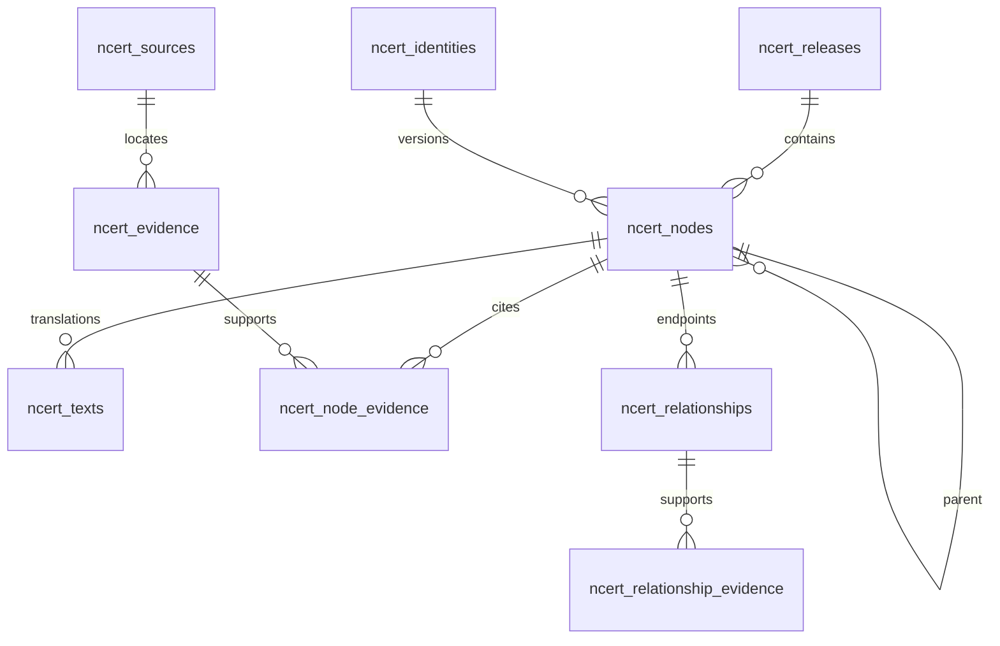

# NCERT catalogue integration contract v1
The 13 empty catalogue models exist; importer, catalogue read service and publication lifecycle remain unimplemented. No published catalogue exists. This contract includes proposed behavior that is not a runtime guarantee. All model imports: backend.app.models.ncert_catalogue. Shared Base: backend.app.db.session.Base.

## Exact schema notation
S=String(36) UUID text, T=Text, I=Integer, B=Boolean, D=DateTime(timezone=True), J=JSON. All fields NOT NULL unless ?. Each table has id:S PK unless composite PK stated. Foreign keys indexed, ON DELETE RESTRICT. Enums String(40)+CHECK (portable SQLite/PostgreSQL). UTC timestamps normalized on SQLite. U denotes unique constraint. No school_id in catalogue.

Model | table | fields (in addition to id)
---|---|---
CatalogueRelease | ncert_releases | release_key:String(120) U, edition:T, academic_year:String(9)?, status:String(40), created_at:D, published_at:D?, batch_id:S FK ncert_batches.id
CatalogueIdentity | ncert_identities | authority_key:String(200) U, kind:String(40)
CatalogueNode | ncert_nodes | release_id:S FK ncert_releases.id, identity_id:S FK ncert_identities.id, parent_id:S? FK ncert_nodes.id, kind:String(40), grade_number:I?, sequence:I, verification:String(40), completeness:String(40), batch_id:S FK ncert_batches.id; U(release_id,identity_id), U(release_id,id); index(release_id,kind,parent_id)
CatalogueText | ncert_texts | node_id:S FK ncert_nodes.id, language:String(35), title:T, outcome_text:T?, origin:String(40), source_language:String(35), evidence_id:S? FK ncert_evidence.id, verification:String(40), method:T?, reviewer:T?, reviewed_at:D?; U(node_id,language)
CatalogueSource | ncert_sources | publisher:T, title:T, document_type:String(40), grade_scope:T, subject_scope:T, edition:T, publication_year:I?, language:String(35), official_url:T, retrieved_at:D, rights_status:String(40), rights_decision:T?, access_status:String(40); U(official_url,language,edition); empty edition means unknown
CatalogueEvidence | ncert_evidence | source_id:S FK ncert_sources.id, locator:T, supported_claim:T, batch_id:S FK ncert_batches.id; U(source_id,locator,supported_claim)
CatalogueNodeEvidence | ncert_node_evidence | node_id:S FK ncert_nodes.id, evidence_id:S FK ncert_evidence.id; composite PK both; no id
CatalogueRelationship | ncert_relationships | release_id:S FK ncert_releases.id, source_node_id:S FK ncert_nodes.id, destination_node_id:S FK ncert_nodes.id, relationship_type:String(40), directionality:String(40), explanation:T, overlapping_outcomes:T, uncovered_outcomes:T, coverage_assessment:T, verification:String(40), creation_method:String(40), reviewer:T?, reviewed_at:D?, recovery_eligible:B default false, batch_id:S FK ncert_batches.id; U(release_id,source_node_id,destination_node_id,relationship_type,directionality)
CatalogueRelationshipEvidence | ncert_relationship_evidence | relationship_id:S FK ncert_relationships.id, evidence_id:S FK ncert_evidence.id, role:String(40); composite PK all three; no id
CatalogueRelationshipOutcome | ncert_relationship_outcomes | relationship_id:S FK ncert_relationships.id, outcome_node_id:S FK ncert_nodes.id; composite PK both; no id
CatalogueBatch | ncert_batches | manifest_sha256:String(64) U, importer_version:String(40), started_at:D, finished_at:D?, status:String(40), report:J
CatalogueReview | ncert_reviews | node_id:S? FK ncert_nodes.id, relationship_id:S? FK ncert_relationships.id, reviewer:T, reviewed_at:D, decision:String(40), rationale:T; CHECK exactly one target
CatalogueLineage | ncert_lineage | old_identity_id:S FK ncert_identities.id, new_identity_id:S FK ncert_identities.id, release_id:S FK ncert_releases.id, reason:String(40), evidence_id:S FK ncert_evidence.id; composite PK first three; no id

Typed nodes consolidate six redundant entity tables with FK-safe relationship endpoints. Kinds GRADE,SUBJECT,CHAPTER,TOPIC,SUBTOPIC,LEARNING_OUTCOME. Exact parent grammar in that order; grade alone has null parent and grade_number 1..12. Other grade_number null. Parent same release; identity.kind matches node.kind. sequence>=0; sort ties by id. Unique grade per release validated transactionally. Missing intermediate structure stays draft; never fabricate it. Release->nodes 1:N; identity->versions 1:N; node->texts 1:N; nodes/evidence and relationships/evidence/outcomes M:N. Shared outcomes use outcome junctions, not copied texts.



## Enums and publication
release status DRAFT|PUBLISHED|WITHDRAWN; batch STAGED|VALIDATED|PUBLISHED|FAILED.
verification SOURCE_VERIFIED|EXPERT_VERIFIED|AI_SUGGESTED|AWAITING_REVIEW|REJECTED; completeness VERIFIED|PARTIAL|UNAVAILABLE|AWAITING_RIGHTS_REVIEW.
source document_type TEXTBOOK|SYLLABUS|LEARNING_OUTCOMES|FRAMEWORK|NOTICE|CATALOGUE|GOVERNMENT_REPORT; access_status FULL_REVIEW|DISCOVERY_ONLY|INACCESSIBLE; rights_status PERMISSION_REQUIRED|RIGHTS_REVIEW_REQUIRED|METADATA_APPROVED|CONTENT_APPROVED|DENIED.
translation origin OFFICIAL_ORIGINAL|OFFICIAL_TRANSLATION|HUMAN_TRANSLATION|MACHINE_TRANSLATION. lineage reason SPLIT|MERGE|REPLACED.
Published nodes require verified evidence and scoped rights clearance. outcome_text only on outcome nodes with content permission. No universal priority/difficulty/duration/Core/Optional columns. Estimates belong to school plans with method, author/model version, units and provenance; never labelled official without evidence.

## Stable IDs
Identity UUIDv4 assigned once in persistent checked-in identity manifest. authority_key is opaque accession, not title/path; distinguish local accession from official source code. UUIDv5 namespace 97c9f8e0-2c87-4d30-9eb3-408e56820611: release ID from release_key; node ID from release_key + ':' + identity UUID. All other IDs UUIDv4 persisted in manifest and reused. Reimport identical manifest is no-op. Titles/corrections/moves preserve identity; new edition/correction release uses new release_key and node IDs. Published releases immutable. Splits/merges receive new identities with explicit lineage and no automatic equivalence. School plans pin release and node. Never match only by title.

## Relationships
Types PREREQUISITE|SAME_SUBJECT_DEPENDENCY|CROSS_SUBJECT_CORRELATION|SHARED_LEARNING_OUTCOME|CONCEPTUAL_REINFORCEMENT. directionality DIRECTED|SYMMETRIC. Prerequisite/dependency directed source-before-destination and jointly acyclic. Shared outcome/reinforcement symmetric. Correlation either. Symmetric endpoints lexical sort. No self edges. Endpoints only TOPIC/SUBTOPIC/LEARNING_OUTCOME, same release. Same-subject dependency shares subject ancestor; cross-subject correlation differs.
creation_method OFFICIAL_SOURCE_DERIVED|EXPERT_REVIEWED|AI_SUGGESTED|MANUALLY_ENTERED. Evidence role SOURCE_ENDPOINT|DESTINATION_ENDPOINT|RELATIONSHIP. Verified edge needs all three evidence roles, reviewer/time, clear overlap, nonoverlap and coverage analysis. Official derivation requires explicit source assertion; expert inference labelled as such. Keyword similarity insufficient. AI_SUGGESTED never verified until recorded human review/new release snapshot. Review records append-only; latest decision matches snapshot.
Recovery eligibility requires verified status, rights-cleared evidence, coverage assessment and outcome junctions. Only authorizes human consideration; never skips/marks taught. Directed reverse coverage needs separate assessment. Contradictory edges fail review.

## Language
Canonical BCP47 tags en/hi/ur; normalize with library, support further scripts/regions. Identity independent of language. Language as school subject differs from source medium. Official translations require their own evidence. Machine translations require provider/version method, provenance/review and cannot be SOURCE_VERIFIED. Missing text remains missing; explicit fallback returns requested_language/resolved_language/origin, never silently English.

## Import, validation and transactions
Codex service files backend/app/services/ncert_import_service.py and ncert_catalogue_service.py own writes/read filters. Import metadata manifests plus identity registry, not restricted files. Validate scoped rights/source provenance first, stage, check IDs/duplicates/FKs/parent grammar/same-release constraints, language provenance, endpoint evidence, contradictory edges and prerequisite cycles. Diff additions/removals/moves/title corrections/lineage against explicit predecessor. Missing data stays incomplete. No deletion of school plans.
Canonical sorted-key UTF8 JSON with stable array ordering -> SHA256 manifest. Unique batch hash; single-writer SQLite lock or PostgreSQL advisory transaction lock. Stage atomically; publish in separate transaction after revalidation. Failure rollback and report in independent transaction. Same hash returns existing result. Withdraw published release for recovery; never delete history. Backup before additive migrations; SQLite PRAGMA foreign_keys on every connection. Explicit model import before create_all. Never drop_all/reset seeds.
Validation report exact JSON fields: batch_id:string, manifest_sha256:string, counts:{sources:int,nodes:int,texts:int,relationships:int,evidence:int}, failures:[{code:string,record_id:string|null,detail:string}], warnings:same shape, diff:{added:int,removed:int,moved:int,changed:int}, publishable:boolean. Counts actual staged rows. Codes RIGHTS_BLOCKED|SOURCE_MISSING|ID_CONFLICT|DUPLICATE|BROKEN_FK|INVALID_PARENT|CYCLE|RELATIONSHIP_CONFLICT|UNVERIFIED|TRANSLATION_MISSING. Any failures block publication.

## SQLAlchemy consumer contract
```python
from sqlalchemy import select
from sqlalchemy.orm import aliased
from backend.app.models.ncert_catalogue import CatalogueNode, CatalogueRelationship, CatalogueEvidence, CatalogueNodeEvidence
Grade = aliased(CatalogueNode)
Subject = aliased(CatalogueNode)
subjects = (await session.scalars(select(Subject).join(Grade, Subject.parent_id == Grade.id).where(Grade.release_id == release_id, Grade.grade_number == grade, Subject.identity_id == subject_identity_id))).all()
children = (await session.scalars(select(CatalogueNode).where(CatalogueNode.release_id == release_id, CatalogueNode.parent_id == parent_id).order_by(CatalogueNode.sequence, CatalogueNode.id))).all()
# Walk children for chapter -> topic -> subtopic -> outcome; enforce expected kind.
verified = (await session.scalars(select(CatalogueRelationship).where(CatalogueRelationship.release_id == release_id, CatalogueRelationship.verification.in_(['SOURCE_VERIFIED','EXPERT_VERIFIED'])))).all()
citations = (await session.scalars(select(CatalogueEvidence).join(CatalogueNodeEvidence, CatalogueNodeEvidence.evidence_id == CatalogueEvidence.id).where(CatalogueNodeEvidence.node_id == node_id))).all()
```
Catalogue service additionally checks PUBLISHED release, source permissions and authorization; raw query is not an authorization boundary. Recovery additionally filters recovery_eligible and checks exact planned outcomes. Learning outcomes retrieved through hierarchy or relationship_outcomes, never inferred from titles. No async lazy loads.
New Claude-owned /api/v1/ncert GET /releases; /releases/{id}/hierarchy?grade=1&subject_identity_id=UUID&language=hi; /nodes/{id}/outcomes; /nodes/{id}/relationships?verified_only=true; /nodes/{id}/citations. Existing APIs unchanged. Explicit release required; no silent latest. verified_only defaults true; suggestion access explicit and authorized. 404 unknown ID; 409 unpublished/withdrawn/release mismatch; 422 invalid grade/language; 403 restricted content. Pagination limit default100/max500, opaque cursor sequence/id order, next_cursor nullable.
Current empty JSON example, not fabricated curriculum:
```json
{"release_id":null,"items":[],"completeness":"UNAVAILABLE","reason":"NO_PUBLISHED_RELEASE","requested_language":"hi","resolved_language":null,"translation_origin":null,"citations":[],"next_cursor":null}
```
Future node response fields: id:string, identity_id:string, release_id:string, kind:string, parent_id:string|null, sequence:integer, title:string|null, learning_outcomes:array, children:array, verification:string, completeness:string, citations:[{source_id:string,locator:string,rights_status:string}]. Runtime URLs/content only with permission. Empty does not mean subject officially absent; research completeness and permission are separate.

## Ownership
Codex exclusively owns ncert_* tables, model module, import/read services, identity/source manifests and validation. Claude owns school plans/baseline/revisions, period slots/losses, Core/Optional classifications, estimates, completion events, recovery proposals, HTTP APIs/frontend. School tables reference catalogue node/release with RESTRICT; never duplicate master entities. Claude must document exact school schema separately before coding. No guessed 60/40 rules, day conversions, current editions, language availability or AI-verified correlations. Rescheduled/homework is not classroom completion.

## Phase 1 foundation clarification — 2026-11-09
The 13 catalogue models now exist at the documented import path. Migration backend/migrations/001_ncert_catalogue.py exposes upgrade(sync_connection), usable with AsyncConnection.run_sync inside engine.begin after backup. It creates only catalogue tables and rejects column mismatches; no destructive downgrade. Startup explicitly registers models; SQLite application connections do not yet enforce FKs because legacy demo seed ordering fails under enforcement. Additional DB constraints enforce unique grade per release, root shape, rights decision presence, edge direction/order, reviewer/time for verified edges and recovery verification.
Cross-row hierarchy/release, cycles, provenance, scoped permissions and immutable publication still require the future importer. This step supplies no content importer or publication API; direct ORM writes are not an approved ingestion interface. CATALOGUE_MODELS and catalogue_metadata() expose mapped classes/isolated schema; release_id(key) and node_id(key,identity_uuid) implement deterministic IDs. No runtime records seeded.

### SQLite compatibility correction
Application-engine FK enforcement was experimentally tested and removed: the existing demo seed inserts assessments before their FK parents are flushed. Global enforcement breaks startup. Catalogue constraint tests use a separate FK-enabled connection. Production catalogue writes/imports remain prohibited until a coordinated legacy seed-order fix and FK-enabled write connection are supplied. No importer exists in this foundation. This correction supersedes the earlier statement that application SQLite connections enforce FKs. PostgreSQL validation currently means DDL compilation only, not a live database test. Publication immutability and cross-row validation are pending importer work, not guarantees of raw ORM writes.


## Documentation authority and current scope — 2026-11-09
Canonical curriculum documentation is apps/lumeneios/docs/, as referenced by root AGENTS.md and CLAUDE.md. Existing root docs/ copies are retained as compatibility mirrors; they are not a second contract. Proposed future consolidation: replace root Markdown copies with links after team coordination, and retain a single canonical CSV per dataset. No copy deleted in this task.
Current research scope is Mathematics and Science categories, Classes I-XII, including integrated preparatory-stage context only to establish classification, and Physics/Chemistry/Biology for higher-secondary science. No additional board scope has been established. Portal labels do not establish edition equivalence or subject identity. The source register and language matrix distinguish portal labels from observed title-page metadata. A textbook's HTTP URL is a locator, not a stable edition ID: preserve edition/reprint evidence and never silently overwrite history.

## Research-driven schema compatibility review — proposals only
No model/migration changes authorised by this research review.
- Different subject structures: separate SUBJECT identities can represent Mathematics, Science, The World Around Us and higher-secondary Physics/Chemistry/Biology under each grade. The World Around Us must not be relabelled Science. A research category is not a catalogue identity.
- Multiple volumes can be separate CatalogueSource rows supporting the same subject/chapter hierarchy; no invented BOOK curriculum node required. However part/volume is currently only unstructured title metadata.
- Edition/reprint deficiency: CatalogueSource has edition and publication_year but no separate reprint_year, academic-year applicability, publication month, source lifecycle or successor link. The current unique(official_url,language,edition) can collide when NCERT replaces a reprint at the same URL without changing its edition. This prevents lossless bibliographic history.
- Smallest proposed additive source correction (not implemented): part_label:Text nullable; publication_date_text:Text nullable; reprint_date_text:Text nullable; applicable_academic_year:Text nullable; lifecycle_status:String(40) NOT NULL default UNCERTAIN with CURRENT|SUPERSEDED|WITHDRAWN|UNCERTAIN; lifecycle_evidence_id:String(36) nullable FK ncert_evidence.id RESTRICT; supersedes_source_id:String(36) nullable self FK RESTRICT; bibliographic_key:String(200) nullable unique (mandatory for future imports). Replace old URL-based unique constraint only in a separately reviewed migration; its replacement must identify edition+reprint+language+part independently of mutable URL. Until that contract amendment is approved, store exact bibliographic metadata in research CSVs and prohibit affected imports.
- Translation deficiency: CatalogueText records origin/source language/evidence, but lacks an exact source-to-source counterpart and edition-equivalence review. Do not infer identity from a translated title. Proposed later additive CatalogueSourceRelation (separate contract required) would record source/destination source IDs, relation type TRANSLATION_OF|REPRINT_OF|SUPERSEDES, verification, evidence locator and reviewer/time. No relationship is asserted by this review.
- Curriculum outcome deficiency: mandatory GRADE->SUBJECT->CHAPTER->TOPIC->SUBTOPIC->LEARNING_OUTCOME grammar cannot directly represent stage-level or subject-wide outcomes without fabricated parents. Smallest contract proposal is an independently versioned outcome with explicit scope and many-to-many alignment to nodes; do not fabricate subtopics to satisfy the current shape. Publication/import must wait for an approved representation.
- Source evidence and review: node evidence/junctions can capture factual provenance, but source review is currently only access_status and rights_decision text. Retrieval, content verification and legal clearance must remain separate in research artifacts. METADATA_APPROVED does not authorise outcome text or translations.
- Stable identities/releases: suitable in principle, but reprints and divergent translations need explicit edition alignment before sharing curriculum identity. Release WITHDRAWN is not a substitute for individual source withdrawal. Cross-row validation and immutable publication are still unimplemented.
Conclusion: empty foundation can be preserved; schema is not yet sufficient for lossless source bibliographic lifecycle or non-chapter outcome ingestion. Resolve additive contract proposals before any importer work. No raw ORM write may be treated as rights/review enforcement.

## Research interpretation and remaining contract review
Portal part labels and chapter-range parameters are not a verified cross-language chapter map. In particular, some upper-grade Urdu parameters differ from English; these are recorded as an unresolved structural comparison, not proof of omissions or permission to merge variants. A reprint statement recorded from front matter is an observed statement, not necessarily a complete reprint history or the current syllabus applicability.
The contract's UTC normalization and cross-row validation rules are requirements for future services, not enforced behavior of the current raw DateTime columns/ORM. The migration compares column names only and is not a tracked migration runner. No change to those implementation details was made in this research task.
The source bibliography can describe separate NCERT language publications now, but sharing a curriculum identity across their nodes requires reviewed edition/outcome alignment. Do not force divergent language editions into an identical hierarchy or infer official translation from matching titles.

## Active VI-VIII research scope and resource-link contract
Only VI-VIII Mathematics/Science are priority for the current Phase 0 exit gate. I-V and IX-XII observations are preserved but DEFERRED_NOT_EVALUATED_FOR_COMPLETION. The new NCERT_VI_VIII_* CSVs are linked research artifacts, not runtime catalogue tables. Do not implement duplicate tables from their resource/work/combination IDs. Unknown source documents have no fabricated source ID/URL; checked publication channels are recorded separately. Separate syllabus, outcomes, textbook-work, part and language-edition roles must remain distinct. Textbook publisher availability is not automatically a prescription or syllabus.
The official framework and elementary syllabus archive are now directly accessible; the archive contains separate historical English VI-VIII Mathematics/Science syllabi (2006 volume). Its current applicability to new books is unresolved. Explicit textbook references to NCF-SE 2023 verify broad source lineage only. Zero current chapter/topic/outcome mappings are verified. The gate is evaluated in NCERT_PHASE0_CLOSURE_REPORT.md; no importer or integration work is authorised by narrowing scope.

## Active API amendment - 2026-11-10
The user authorises empty-catalogue APIs and persistent editorial decisions without research ingestion. CURRICULUM_API_INTEGRATION_CONTRACT.md supersedes earlier proposed HTTP routes and Claude API ownership: Codex owns backend, Claude frontend. CatalogueMappingDecision (backend.app.models.ncert_review, ncert_mapping_decisions, migration002) is an independent editorial ledger. Original 13 tables/verification enums are unchanged. APPROVED/REJECTED/REVISION_REQUESTED never alter relationship verification, rights, applicability, recovery or release snapshots. Catalogue API connections enforce SQLite FKs locally and restore pool settings; legacy seed is unchanged. Existing source-history/outcome-scope and Phase0 blockers remain; no importer/publication/seed added.
